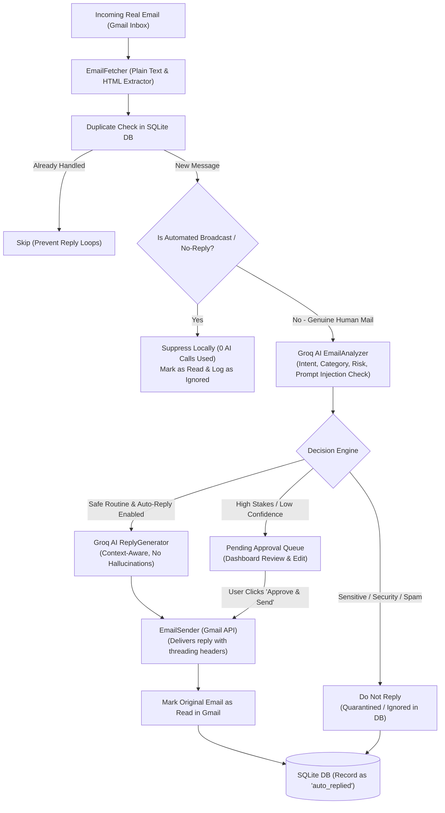

# AI Automatic Email Reply Agent (Hybrid Mode - Groq Powered)

A production-ready, intelligent AI agent that connects to your real Gmail account, monitors incoming emails, deeply understands their intent using **Groq** (`openai/gpt-oss-120b`), dynamically classifies them, and **automatically sends replies** when safe or queues them for human approval.

Includes an interactive **AI Chatbot Assistant** and a **Contact Directory** to effortlessly draft and dispatch emails to mapped roles (like **HOD**, **Class Teacher**, **Mentor**) via natural conversation!

---

## 1. How the Live Hybrid Email Automation Works



---

## 2. Setup Guide

### Step 1: Configure Groq API Key
1. Get an API key from [Groq Console](https://console.groq.com/keys).
2. Open your [.env](file:///d:/santhosh/project/.env) file:
```env
AI_PROVIDER=groq
GROQ_API_KEY=gsk_your_actual_groq_api_key_here
GROQ_MODEL=openai/gpt-oss-120b
AUTO_REPLY_ENABLED=true
```

### Step 2: Set up Gmail OAuth 2.0 Credentials
1. Go to the [Google Cloud Console](https://console.cloud.google.com/).
2. Create a Project and enable the **Gmail API**.
3. Go to **APIs & Services > Credentials > Create Credentials > OAuth client ID**.
4. Application type: **Desktop app**.
5. Download the JSON credentials file, rename it to `credentials.json`, and place it in the project root: [credentials.json](file:///d:/santhosh/project/credentials.json).
6. Authenticate your account:
```powershell
.\venv\Scripts\python.exe run_agent.py --auth
```
*A browser window will open asking you to sign in with your Gmail account and approve the read/send scopes. The generated token will be saved to `token.json`.*

---

## 3. Web Dashboard Features

Run the Streamlit dashboard:
```powershell
.\venv\Scripts\streamlit.exe run dashboard/app.py
```
Open your browser to `http://localhost:8501`.

### 💬 Tab 1: AI Chatbot Assistant
- **Conversational Inquiries**: Ask about your pending emails, inbox activity, or system health.
- **Natural Language Email Dispatch**:
  - Example command: *"Send mail to HOD asking for 2 days leave due to fever, attach class teacher"*
  - The AI resolves roles like "HOD" and "Class Teacher" directly from your Contact Directory.
  - Generates a courteous, professionally phrased subject and body in your name.
  - Previews the draft with an instant **"🚀 Send Email via Gmail Now"** button!

### 👥 Tab 2: Contact & Role Directory
- Map role aliases (e.g., `HOD`, `Class Teacher`, `Mentor`, `Principal`) to their email addresses.
- One-click **"⚡ Pre-fill Sample College Contacts"** button to quickly register standard academic roles.
- Supports adding, updating, and deleting contacts directly from the web interface.

### 📊 Tab 3: Overview & Metrics
- Live operational metrics computed directly from SQLite (Total Processed, Auto-Replied, Pending Approval, Approved & Sent, Ignored).

### ⏳ Tab 4: Pending Approval Queue
- Review emails requiring human verification.
- Edit drafted text, regenerate with different tones (professional, friendly, formal, concise), approve & send, or dismiss.

### ⚡ Tab 5: Automatically Replied
- Audit trail of emails answered autonomously by Groq with rule citations and full reply text.

### 📥 Tab 6: All Processed Emails
- Search and review every inbound email with its AI classification, intent, urgency, and risk score.

### 📜 Tab 7: Activity Logs
- Comprehensive audit log of all automated actions, suppressed notifications, and manual dispatches.

### ⚙️ Tab 8: Settings & Connection
- View Gmail OAuth connection status and Groq configuration.

---

## 4. Running the Background Agent

### Option A: Real-Time Background Monitor Loop (Auto-Reply on Arrival)
Continuously monitors inbox every 60 seconds and auto-replies to safe routine emails:
```powershell
.\venv\Scripts\python.exe run_agent.py --monitor
```

### Option B: Single-Shot Sync Cycle
Inspects unread emails once, processes them, and auto-replies:
```powershell
.\venv\Scripts\python.exe run_agent.py --sync
```

---

## 5. CLI Commands Reference

| Command | Description |
| :--- | :--- |
| `.\venv\Scripts\python.exe run_agent.py --auth` | Complete Google OAuth 2.0 sign-in |
| `.\venv\Scripts\python.exe run_agent.py --sync` | Run one fetch, analyze, and auto-reply cycle |
| `.\venv\Scripts\python.exe run_agent.py --monitor` | Start real-time background loop (polls every 60s) |
| `.\venv\Scripts\python.exe run_agent.py --stats` | View live real statistics from SQLite database |
| `.\venv\Scripts\python.exe run_agent.py --init-db` | Initialize SQLite database schema |
| `.\venv\Scripts\pytest.exe` | Run all 11 unit tests |

---

## 6. Security & Cost-Optimization Principles

1. **Heuristic Pre-Filter (0 API Calls)**: Automated system notifications (`no-reply@...`, Google Classroom announcements, security alerts) are suppressed locally before reaching Groq, dramatically reducing API quota usage.
2. **Anti-Prompt Injection Defense**: Incoming emails are treated as untrusted data. Malicious attempts to hijack system prompts trigger immediate quarantine.
3. **Anti-Loop & Duplicate Prevention**: The SQLite database tracks every processed Gmail message ID. An email is never processed or answered twice.
4. **Sensitive Email Shield**: Financial statements, OTP codes, password resets, and security notices are strictly prevented from automated responses.
5. **Zero-Hallucination Policy**: High-stakes messages (job offers, legal agreements) are always routed to the human approval queue.
